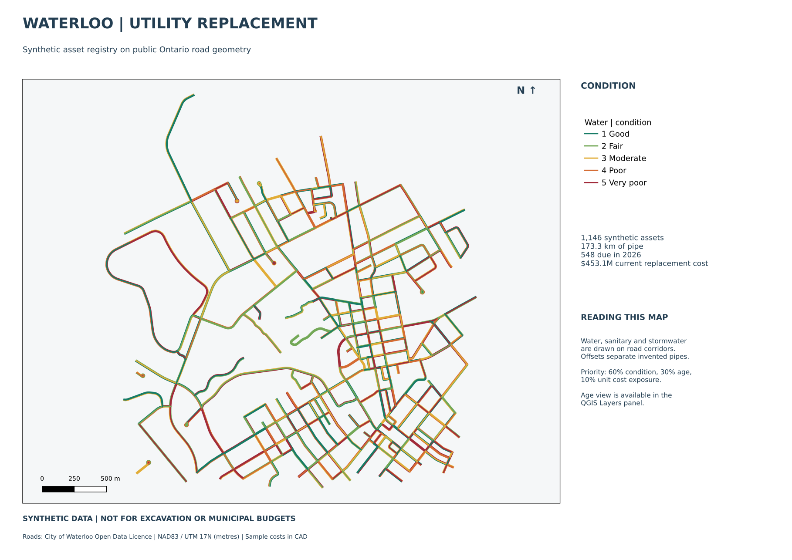

# Municipal asset map

I built a map of water, sewer and stormwater pipes because I wanted to see how a replacement list changes when I can see both the assets on a map and the cost over time. I use real public roads in Waterloo, Ontario, with invented pipe records so I can explore the planning without exposing any real utility information.

I can click a pipe to inspect its age, condition and replacement priority, switch between systems, and compare future spending in a spreadsheet. The example has **1,146 synthetic assets across 382 road segments**. Nothing here identifies real buried pipes or supports excavation.

**Try the saved example:** [download this repository](https://github.com/jackaI1/municipal-asset-gis/archive/refs/heads/main.zip), unzip it, then open one of these files:

- `outputs/municipal_assets.qgz` in [QGIS](https://qgis.org/), a free desktop mapping program. The `assets.gpkg` database must stay beside it. Start with the condition layers; turn on the age group to compare older pipes.
- `outputs/replacement_map.pdf` for the printable A3 map.
- `outputs/lifecycle.xlsx` in Excel. The first sheet has a PivotTable, an interactive summary of cost by system and year, and a chart for the first ten years. The Assets sheet contains the underlying schedule.
- `outputs/web_map.html` in a browser for a smaller sharing view. Hover over pipes and use the system switches. Its map libraries and optional street tiles need internet.



## What I look at

Colour shows condition from 1 (good) to 5 (very poor). The priority score runs from 0 to 100: condition contributes 60%, age relative to expected life contributes 30%, and unit cost contributes 10%. Higher scores put worse, older and more expensive-to-replace pipes near the top of `outputs/ranked_assets.csv`.

The schedule places poor pipes and overdue replacements in the base year, then schedules the others at the end of their assumed life. I calculate cost from pipe length and a sample cost per metre, with 2.5% annual inflation. The saved example uses 2026 as its base year and identifies 548 replacements due that year. These are sample planning rules and costs, not a municipal budget or an engineering recommendation.

## Rebuild it

For the data, spreadsheet and web map, I use Python 3.10 or newer:

```sh
python3 -m venv .venv
. .venv/bin/activate
pip install -r requirements.txt
PYTHONPATH=src python -m municipal_gis.pipeline
python -m pytest -q
```

Change `data/input/registry.csv` to try different condition ratings, installation years or unit costs, then rerun the pipeline. It rejects missing values and bad records instead of guessing. To keep a second scenario:

```sh
PYTHONPATH=src python -m municipal_gis.pipeline --out build/scenario --as-of-year 2027
```

For the desktop project and printed map, I use QGIS's Python bindings, called PyQGIS. On Ubuntu 24.04, starting from a fresh checkout:

```sh
sudo apt-get update
sudo apt-get install -y python3-qgis python3-venv fonts-dejavu-core
/usr/bin/python3 -m venv --system-site-packages .venv
. .venv/bin/activate
pip install -r requirements.txt
PYTHONPATH=src python -m municipal_gis.pipeline
QT_QPA_PLATFORM=offscreen PYTHONPATH=src python -m municipal_gis.qgis_project
QT_QPA_PLATFORM=offscreen python -m pytest -q
```

Use a fresh virtual environment for this route: an existing environment made with another Python installation will not inherit Ubuntu's QGIS package. On other systems I can open the saved project directly; the complete automated build runs in GitHub Actions, with downloadable outputs on each successful run.

## Data and design

The road shapes come from [City of Waterloo Open Data](https://data.waterloo.ca/), under its Open Data Licence. The [City's reuse guidance](https://www.waterloo.ca/council-and-city-administration/open-data-and-maps/) explains that licence. I keep a bounded snapshot and its exact query, retrieval date and checksum in `data/base/`, so a normal build needs no live data request.

The pipes, condition ratings, installation years, costs and offsets are all synthetic. QGIS is an open-source GIS with mapping and analysis functions comparable to ArcGIS Pro; this project uses QGIS and does not require or demonstrate use of ArcGIS Pro itself.

[The method notes](docs/method.md) explain the formula, sample assumptions, data fields, Excel refresh steps and limitations. GeoPandas handles map data in Python, measuring lengths in metres before calculating costs. PyQGIS builds the desktop project, condition and age styles, and print layout. Both programs use the same GeoPackage, a single file containing the shapes and their records.

## Checks

The test suite covers cleaning, scoring, costs, scheduling, spatial joins, export reconciliation, the native Excel PivotTable cache and QGIS project portability. Plain Python runs 36 tests and skips the QGIS test when its bindings are absent. GitHub Actions installs QGIS and runs all 37 tests, including moving the project folder, reading every layer and checking visible pipe colours in the exported map. It also builds the PDF and map image from the saved print layout.
